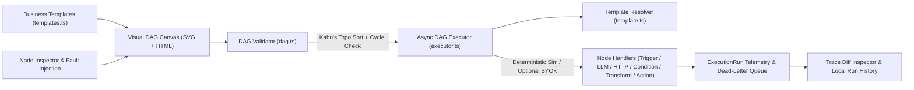

# FlowForge — Visual DAG AI Workflow Studio

FlowForge is a browser-based, dark-first visual workflow studio for designing, validating, and executing Directed Acyclic Graph (DAG) AI automation pipelines. It combines a custom zero-dependency SVG+HTML node-graph editor with a deterministic execution engine supporting topological scheduling, conditional branch routing, mustache variable interpolation, configurable retries, fault injection, and dead-letter telemetry.

## Architecture



## Core Capabilities

- **Interactive Visual DAG Canvas**: Custom SVG+HTML node-graph workbench with smooth node dragging, live cubic-bezier edge rendering, animated cyan flow pulses, port-to-port edge creation, click-to-delete edges, and zoom/pan/reset controls.
- **Live Cycle Detection**: Connecting any edge that would introduce a self-loop or directed cycle is rejected immediately via `wouldCreateCycle` with an inline validation toast.
- **4 Prebuilt Business Automation Templates**:
  1. **Customer Support Triage & Priority Routing** — Webhook -> Sentiment/Intent LLM -> Priority Router -> Jira Incident + Slack Page / Standard Reply
  2. **AP Invoice Extraction & Xero Validation** — Document Trigger -> Structured Line-Item LLM -> GST & ABN Validator -> Validation Gate -> Xero ERP Sync / AP Exception Queue
  3. **B2B Lead Enrichment & CRM Scoring** — Demo Form -> Clearbit Company Lookup -> ICP Fit Scorer LLM -> Threshold Router -> HubSpot Deal Upsert / Nurture Sequence
  4. **Production Incident Root-Cause Summary** — Datadog Alert -> Log Cluster Parser -> RCA Synthesizer LLM -> Severity Gate -> PagerDuty Bridge / Engineering Digest
- **Node Inspector & Fault Injection**: Edit labels, prompts/expressions (`{{nodeId.field}}` with upstream variable autocomplete chips), retry policies (`maxRetries`, `backoffMs`), and toggle **Simulate Failure** (`Transient: Fail Attempt 1 -> Retry Succeeds` or `Persistent: Exhaust Retries -> Dead-Letter`) to test resilience live.
- **Optional BYOK LLM Runtime**: Runs deterministically out of the box with realistic simulated outputs; optionally configure any OpenAI-compatible chat completions endpoint in the Settings modal.
- **Execution History & Payload Diff Drawer**: Inspect per-step latency badges, retry attempt counters, side-by-side Input/Output JSON diffs, Dead-Letter Queue entries, and persistent local run history with replay and JSON export.

## DAG Execution Semantics

1. **Topological Ordering (`src/engine/dag.ts`)**: Before execution begins, `topologicalSort` runs Kahn's algorithm with deterministic tie-breaking (canvas X, then Y, then node ID). Cyclic graphs fail fast before any node executes.
2. **Safe Template Interpolation (`src/engine/template.ts`)**: Expressions such as `{{trigger.customerEmail}}`, `{{trigger.tags.0}}`, and `{{classifier.owner | "unassigned"}}` are resolved against upstream node outputs with explicit guards against prototype pollution (`__proto__`, `constructor`, `prototype`).
3. **Conditional Branch Skipping (`src/engine/executor.ts`)**: Every edge carries a condition (`always`, `true`, `false`, or `error`). Downstream nodes only execute if at least one incoming edge is active; untaken branches (and their transitive descendants) are cleanly marked `skipped` with a clear `skipReason`.

## Retry & Error-Handling Design

- Each node defines `retryPolicy: { maxRetries, backoffMs }`.
- On failure, the executor transitions the node state to `retrying`, waits `backoffMs`, and re-invokes the handler up to `1 + maxRetries` total attempts.
- If retries are exhausted, the node is marked `error`, a structured `DeadLetterEntry` (including error trace, attempt count, and input context) is appended to `ExecutionRun.deadLetters`, downstream `always` edges are skipped, and any explicit `error` edge is activated for dead-letter recovery.

## Local Development

```bash
pnpm install
pnpm run dev
```

Copy `.env.example` to `.env` if you wish to pre-populate a BYOK OpenAI-compatible endpoint:

```bash
cp .env.example .env
```

## Verification & Testing

```bash
pnpm run typecheck   # Strict TypeScript check (tsc --noEmit)
pnpm test            # Vitest unit test suite (20 tests across dag, template, executor)
pnpm run build       # Production static build (configured with base: './' for GitHub Pages)
```

## License

MIT
